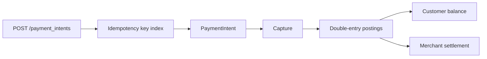

# go-ledger

**Live page:** https://itsoumya-d.github.io/go-ledger/

**A compact, tested Go service for idempotent payment intents and double-entry ledger postings.**

This is a reference implementation, not a production payment system. It exists to make the
financial-correctness ideas concrete: idempotency keys, double-entry postings, insufficient-funds
handling, and capture-once semantics under concurrency.

## What it proves

- **Idempotent creation:** replaying the same `Idempotency-Key` and payload returns the original
  intent; reusing the key with a different payload returns `409`.
- **Double-entry postings:** capture writes a debit and a credit that sum to zero.
- **Capture exactly once:** concurrent captures produce one posting pair, not ten.
- **Insufficient funds:** a failed capture leaves balances and postings untouched.
- **Validation:** positive amounts, ISO-4217-style currency codes, required account IDs and keys.

## API

```bash
# fund an account (dev helper)
curl -s -X POST localhost:8080/v1/accounts/customer_a/fund \
  -H 'Content-Type: application/json' \
  -d '{"amount_cents":1000}'

# create an intent (idempotent)
curl -s -X POST localhost:8080/v1/payment_intents \
  -H 'Content-Type: application/json' \
  -H 'Idempotency-Key: order-42' \
  -d '{"account_id":"customer_a","amount_cents":400,"currency":"USD"}'

# capture
curl -s -X POST localhost:8080/v1/payment_intents/pi_1/capture

# balance
curl -s localhost:8080/v1/accounts/customer_a/balance
```

## Architecture



The store is in-memory and guarded by a mutex. That is deliberate: the point is the invariants,
not a database integration. A production version would put the idempotency index and postings in
a transactional store with a unique constraint on the key.

## Run

```bash
go test -race ./...
go vet ./...
go run .
```

## CI

GitHub Actions runs `go test -race ./...`, `go vet ./...` and `go build ./...` on every push.

## Limitations

- In-memory only; state is lost on restart.
- No authentication, authorisation, rate limiting or PCI scope.
- No real money, no card data, no settlement files.
- Single-currency balances; no FX.
- The dev funding endpoint is not a production API.

If you are evaluating this for a payments role, the interesting parts are `CreateIntent`,
`Capture`, and the concurrency test — not the HTTP wrapper.
