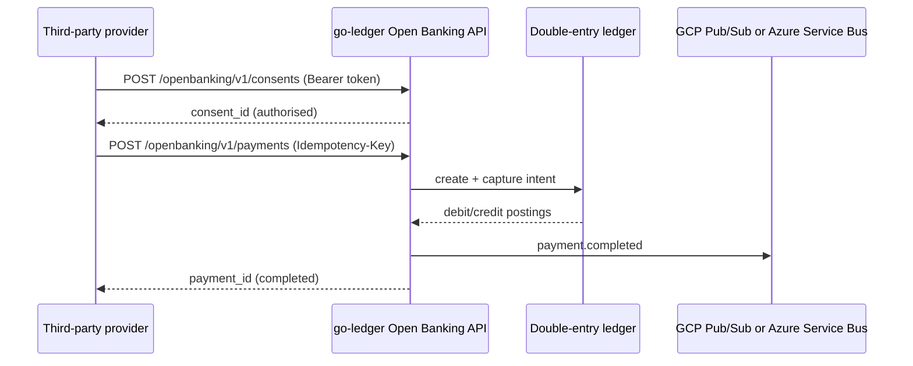

# Open Banking reference flow

This service models the parts of an Open Banking payment that must be correct
before scale: consent, strong customer authentication, idempotency, double-entry
postings, and an auditable event trail.

## Flow



## Security model

- **OAuth 2.0 / OpenID Connect:** the API expects a bearer access token. In a
  production deployment the token is validated against the identity provider's
  JWKS and the `scope` claim must contain `payments`.
- **Financial-grade API (FAPI):** the production profile uses PKCE, signed
  request objects, `mTLS`-bound access tokens, and certificate-bound refresh
  tokens. The local token is a development shim only.
- **Mutual TLS:** the ingress terminates mTLS with a private CA; the client
  certificate thumbprint is bound to the access token (`cnf.x5t#S256`).
- **Idempotency:** `Idempotency-Key` is scoped to the consent and account. A
  replay returns the original payment; a different payload returns `409`.
- **Audit:** every consent and payment emits a typed event. When `DATABASE_URL`
  is set, events are also written to the PostgreSQL `ledger_audit_events` table.

## Ledger invariants

- A payment is captured once; replaying capture is a no-op.
- Debits and credits sum to zero for every settlement.
- Insufficient funds leaves balances and postings untouched.
- The in-memory store is a reference implementation; production uses the
  PostgreSQL-backed audit store and a transactional posting table.

## API surface

| Method | Path | Purpose |
|---|---|---|
| POST | `/openbanking/v1/consents` | Create an authorised consent |
| GET | `/openbanking/v1/consents/{id}` | Read consent status |
| POST | `/openbanking/v1/payments` | Create an idempotent payment |
| GET | `/openbanking/v1/payments/{id}` | Read payment status |
| GET | `/openbanking/v1/accounts/{id}/balance` | Read ledger balance |
| POST | `/graphql` | Query intents, balances and postings |
| GET | `/metrics` | Prometheus metrics |

## Local run

```bash
OPENBANKING_TOKEN=dev-token go run .
curl -s -X POST localhost:8080/openbanking/v1/consents \
  -H 'Authorization: Bearer dev-token' \
  -H 'Content-Type: application/json' \
  -d '{"account_id":"customer_a","permissions":["ReadAccounts","WritePayments"]}'
```

The demo account `customer_demo` is funded with 10,000 cents at startup.
